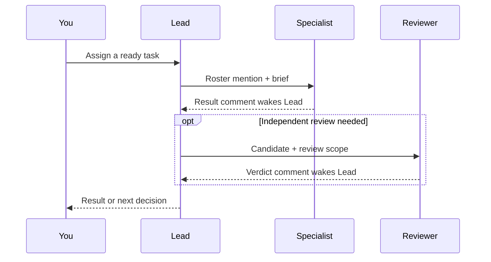

# Multica Engineer Practices

A Multica starter with **nine agent roles, five squad presets, and twelve method skills** for research, analysis, design, and software delivery.

Give a clear task directly to its specialist. For work that needs coordination, assign it to a squad: **Lead chooses who works next, sends a focused brief, and evaluates what comes back.** Specialists join for a concrete contribution.

[Agent triggers](#who-gets-triggered) · [Role selection](#what-makes-lead-select-a-role) · [Squad rosters](#squad-rosters) · [Setup](#install-and-test-a-fresh-workspace)

## Who gets triggered?

This is the squad route. Each arrow that starts work is an explicit assignment or callback.



**Backlog parks work.** A ready squad assignment wakes Lead; its exact roster mention starts the selected agent. Lead records its decision and ends the dispatch run. Workers post substantive results through the supplied return route. In this kit's comment-return route, a plain result comment lets Multica wake Lead. Squad instructions reach Lead, so each assignment carries the context the worker needs. See the official [squad execution and callback rules](https://multica.ai/docs/squads).

Blocking review findings send the affected work back to its owner for repair and a focused recheck. A human checkpoint resumes only when the relevant approval is present. Lead checks existing work before dispatching so a callback does not create another copy of the same assignment. The [leader loop guide](docs/leader-loop.md) covers these decisions.

This follows the supervisor/subagent pattern described in [LangChain's Subagents guide](https://docs.langchain.com/oss/python/langchain/multi-agent/subagents): a coordinator selects specialists and integrates their results. This kit implements that coordination through Multica issues and agent runs; worker context and session persistence follow the configured runtime.

## What makes Lead select a role?

Lead selects from the current squad's roster. The question, required output, and consequence of getting it wrong determine which expertise is needed.

| Role | Trigger for using it | Returns |
| --- | --- | --- |
| [Scout](agents/scout.md) | An unfamiliar topic, missing sources, or competing approaches. | A source map, options, and useful questions. |
| [Paper Reviewer](agents/paper-reviewer.md) | A paper or scientific mechanism needs close examination. | A full critical review, evidence limits, and proposed experiments. |
| [Analyst](agents/analyst.md) | Data or measurements need interpretation. | Reproducible analysis and qualified conclusions. |
| [Product Manager](agents/product-manager.md) | Stakeholder needs, scope, or an explanation needs attention. | Clear requirements or a grounded explanation of the work. |
| [Systems Engineer](agents/systems-engineer.md) | Behavior, architecture, interfaces, or state ownership needs a decision. | Design options, contracts, and a buildable approach. |
| [Software Engineer](agents/software-engineer.md) | A specified change, prototype, or repair is authorized. | A candidate implementation and its checks. |
| [Test & Code Review Engineer](agents/test-code-review-engineer.md) | Code and test effectiveness need independent assessment. | Findings, a scoped verdict, and closure checks. |
| [Verifier](agents/verifier.md) | A scientific, measured-benefit, or consequential design claim needs independent assessment. | Evidence assessment, uncertainty, and applicability limits. |

[Lead](agents/lead.md) owns routing, dependencies, the remaining budget, human decisions, and the integrated answer. Product Manager's explanation is optional and can be requested at any stage. A direct specialist request returns to you without requiring a squad. Independent assignments can run in parallel when ownership and outputs are distinct.

## Squad rosters

A preset chooses the available team and its coordination policy. Start with the one that fits the task; a change of working mode can use an explicit handoff.

| Squad / preset | Team available alongside Lead |
| --- | --- |
| [Open Research Squad](squads/open-research.md) · `open-research` | Scout, Paper Reviewer, Analyst, and Verifier for questions, literature, and research evidence. Inquiry can finish with understanding or a valid negative result. |
| [Engineering Design Squad](squads/engineering-design.md) · `engineering-design` | Systems Engineer and Verifier for behavior and design decisions; Product Manager and software specialists contribute when needed. |
| [Analytics Engineering Squad](squads/analytics-engineering.md) · `analytics-engineering` | Analyst, Software Engineer, Test & Code Review Engineer, and Verifier for analysis and justified changes; Systems Engineer joins for consequential system choices. |
| [Software Delivery Squad](squads/software-delivery.md) · `software-delivery` | Software Engineer and Test & Code Review Engineer for implementation and repairs; Systems Engineer, Product Manager, and Verifier join for distinct questions. |
| [Engineering Practice Squad](squads/research-engineering.md) · `research-engineering` (default) | All eight specialists available for work that crosses research, analysis, design, and delivery. |

The same agent identities can serve several squads. Runtime access and permissions still apply. Open Research uses its own [coordination policy](squads/research-common.md); engineering squads use [shared engineering coordination](squads/common.md). See [Research → Design → Delivery](docs/research-design-delivery.md) for handoffs.

## Install and test a fresh workspace

Run on the machine and account that will execute the agents. Use Python 3.12 or newer for the full dependency pack and an authenticated Multica CLI 0.7.1 or newer.

```bash
multica auth status
multica workspace list --full-id
multica --workspace-id WORKSPACE_UUID runtime list --output json
cp setup.example.toml setup.local.toml
```

Replace `WORKSPACE_UUID` with the selected workspace ID. In `setup.local.toml`, set `multica.workspace_id` and `multica.runtime_id`. Add that runtime to `host.local_runtime_ids` only if it runs on this host. A workspace member ID is different from a runtime ID. For a named CLI connection, use the same profile for discovery and configuration.

```bash
python3 -B scripts/setup.py --config setup.local.toml --plan
python3 -B scripts/setup.py --config setup.local.toml --apply
python3 -B scripts/setup.py --config setup.local.toml --doctor
```

Setup provisions pinned host tools and configures the agents, methods, and squads. Doctor checks host/configuration readiness; observe actual agent routing separately. Follow the [complete setup and generic pilot guide](docs/new-workspace-pilot.md). For an existing installation, use the [refresh guide](docs/multica-installation.md); a deliberate refresh needs `update_existing=true`. The [manual configuration guide](integrations/multica/README.md) is also available.

Official Multica references: [agent configuration](https://multica.ai/docs/agents-create), [skills](https://multica.ai/docs/skills), [squad setup](https://multica.ai/docs/squads), and the [complete tutorial](https://multica.ai/docs/tutorial). Architecture and setup references checked **2026-11-02**.

## Working depth and evidence

Choose the requested outcome: a research answer, design proposal, bounded prototype, or accepted roadmap increment. A clear request carries its scope and authority. Substantial roadmap work follows the [working rules and human checkpoints](docs/workflow.md); a quick MVP uses the [compact brief](templates/quick-mvp.md). Implementation and review detail stay with the responsible task, and Lead returns the substantive result.

The twelve [method skills](docs/skill-design.md) support the roles with procedures and working resources. Tools must be available in the worker's runtime; see [PDF capabilities](docs/pdf-capabilities.md) and [validation limits](VALIDATION.md). Generic pilot cases are authored public examples. Their presence, or a successful import, does not establish that managed runs have passed them.

Worked examples: [research to experiment](examples/research-to-mvp.md), [analytics to engineering](examples/analytics-to-engineering.md), and [existing code to reliable delivery](examples/code-to-reliable-delivery.md).

## Sources and public release

[Multica Best Practices](https://github.com/it235/multica-best-practices) informs the separation of agent roles, reusable skills, and squad coordination. See [design decisions and sources](docs/design.md), the [adaptation crosswalk](docs/skill-design.md), [third-party notices](THIRD_PARTY_NOTICES.md), and [LICENSE](LICENSE).

Use the [publication checklist](docs/publication.md) for the reviewed Git file set. Local configuration, runtime records, and historical project evidence stay in ignored paths. Contributions should follow [CONTRIBUTING.md](CONTRIBUTING.md).
